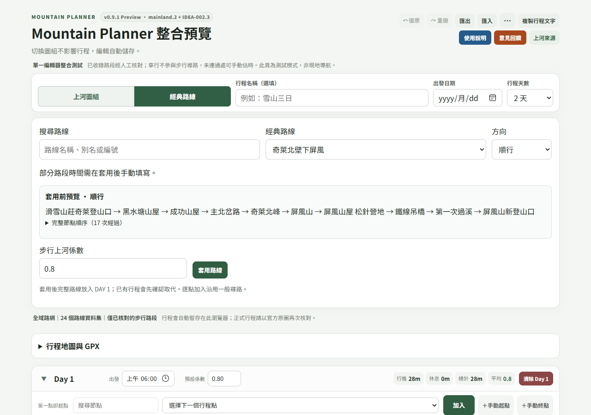
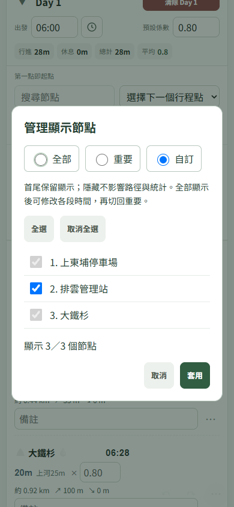

# IDEA-002：UI 精簡、取代行程與 DAY 顯示管理

最新後續修正與現行 R057 狀態見 [套用前預覽與方向控制](IDEA_002_PREVIEW_DIRECTION_20261120.md)。下文保留本階段歷史驗收紀錄。

2026-11-20，依使用者討論後確認的六項需求執行。延續 `65d10c5` 基準及 `codex/idea-002-phase1`，僅修改 Preview、相關測試及文件。此文件的操作規格取代 Phase 2 報告原本的「最後空白／新增 DAY」限制。

## 已完成的行為

- 頂部改為「上河圖組／經典路線」雙按鈕，一次點擊切換；目前選中的按鈕有顏色及 aria-pressed。路線模式隱藏圖組選單，切換或選擇候選不改 DAY。
- 移除套用目標 DAY 選單，改成「套用路線」。有任何行程內容時，先確認取代全部 DAY；取消完全不動。確認後完整路線放入新的 DAY 1，保留復原／重做。空白行程直接套用。
- 取代只重建 DAY：行程名稱與出發日期保留。新 DAY 1 使用既有新行程預設（06:00、係數 0.8）；原 DAY 的時間／備註等可由復原還原。
- 每 DAY 底部新增「管理顯示節點 · 顯示 n／m」，以原生 dialog 開啟全部／重要／自訂模式。自訂以 item ID 逐次控制，提供全選／取消全選，首尾固定顯示。休息不列入節點計數。
- 面板的變更先留在草稿，按套用才更新；取消／Esc 不改資料。不同 DAY 可分別設定，分天後重新計數。
- 「全部」可展開原本合計的隱藏路段，使用原本的逐段時間／係數操作，修改後再回「重要」。合計列仍唯讀，不推估分攤分鐘。





## 單一顯示狀態與相容性

`items[].showInTable` 仍是 DAY 與 IDEA-003 地圖共用的唯一可見狀態，沒有第二份隱藏清單。地圖逐點修改會把該 DAY 設為自訂；DAY 批次修改會更新地圖勾選。

新增選填的 `day.displayMode`（all／important／custom）及 Route occurrence 的 `classicRoute.key`。舊 Route 重要標記由既有 waypoint 作相容讀取；沒有模式的舊行程若已隱藏點，保留為自訂，避免無提示重設。一般手動行程預設全部；重要模式保留手動選點、自訂位置及 Route 指定重要 occurrence。

新加入或分天後的首尾固定顯示。空白下一天繼承來源 DAY 模式；移入已有內容的 DAY 時使用自訂，保留雙方目前逐點選擇。原本聚合線形中間未知定位的分天防呆維持，不補造座標。

JSON、暫存、復原／重做會保存模式及逐點狀態。切換顯示不改 incoming、手動分鐘、來源係數、完整幾何或統計；實際 GPX 內容也保持一致。行程 JSON 驗證器會拒絕不合法的模式及重要標記型別。

## R057 核對紀錄

使用者本輪確認 [OSM way 220625143](https://www.openstreetmap.org/way/220625143) 北稜來源「驗證 OK」。本輪 UI 已反映此確認。這份確認的範圍是所引用的單一 way；其餘串接 way、既有 Node 與 OSM 錨點對照、反向通行以及新方向邊的接入仍未完成。沒有把全 Route 自動改為 verified，也沒有修改權威路網。原始 OSM 候選證據保持原狀。

## 驗證

- 顯示邏輯新增 5 項測試；最後相關顯示／套用／路徑編輯回歸 **48/48** 通過，包含完整 GPX、方向時間、手動分鐘、距離及升降在三模式間不變。
- 最後 JSON 類型／正式版隔離局部檢查 **17/17** 通過。
- 完整 JavaScript：**297/300**。仍為既有的三項 Preview／正式幾何一致性失敗，與前輪相同；完整執行後另補的 GPX 顯示不變測試已於局部回歸通過。
- Python 全套 **127/127** 通過（UTF-8 與既有本機測試依賴）。
- 隔離無頭 Edge **18 個操作情境通過**，pageerror 空。包括按鈕切換、顯示草稿取消、三模式、逐段係數修改保留、同 Node 不同 occurrence 計數、地圖與 DAY 雙向同步、實際 JSON 下載再匯入、取代取消／確認、復原重做、分天計數、DAY 獨立、刷新、路線外搜尋與 390px dialog。
- CSS、修改模組及入口腳本快取版本已更新；語法與 diff 檢查通過。原有 Preview 幾何及其未同步的資料快取指紋沒有被順便重寫。

```sh
node --test tests/day-display.test.mjs tests/classic-route-apply.test.mjs tests/path-editor.test.mjs tests/route-edit-operations.test.mjs
node tools/verify_classic_preview.mjs
node tools/serve_preview.mjs
```

瀏覽器工具需設定 `PLAYWRIGHT_MODULE` 與 `BROWSER_EXECUTABLE`，使用獨立暫存設定檔，不修改使用者原本瀏覽器資料。

仍待處理：R057 完整接入、聚合線形未知中間點定位、R052 多模式、真實手機與新路線 Excel 檔讀回驗收，以及既存資料一致性問題。沒有 commit、推送、合併或正式發布。
