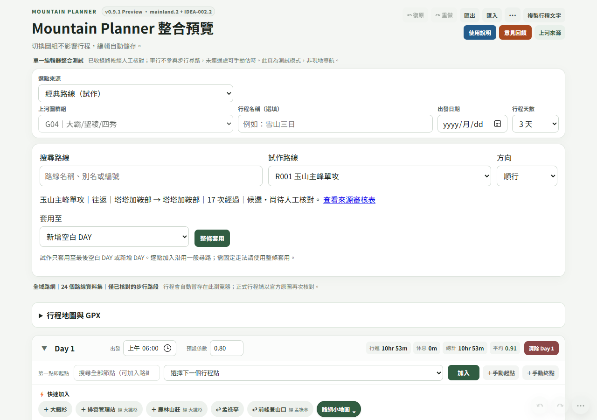
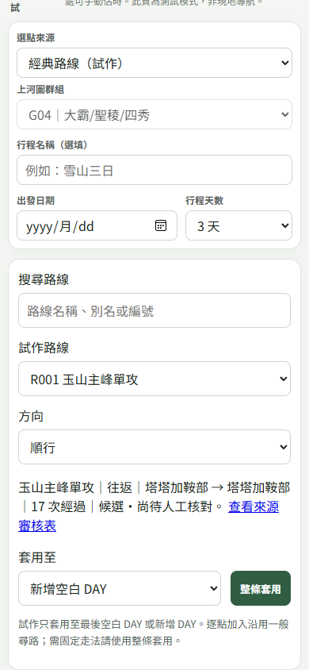

# IDEA-002 Phase 2：經典路線選點與整條套用 Preview

後續已依使用者確認改為按鈕切換、取代全部 DAY 及批次顯示管理；現行操作見 [UI 與顯示管理](IDEA_002_DISPLAY_20261120.md)。本文件保留 Phase 2 當時的驗收紀錄。

基準 `65d10c572b278d96c146d9f2a9d88cd69ba3cdfe`，延續 `codex/idea-002-phase1`。所有變更尚未 commit／推送／合併／發布。正式版、權威 Node／Edge、manifest 與來源幾何沒有修改。

## 試用

執行 `node tools/serve_preview.mjs`，使用輸出的本機 Preview URL。此伺服器只綁定 127.0.0.1，不部署網站。

1. 選點來源切換「經典路線（試作）」；可依名稱、編號及有來源的別名搜尋。此次沒有憑空新增別名。
2. R001 玉山主峰單攻、R015 武陵四秀、R027 雪山西稜可選順／逆方向，查看首尾、類型、完整出現次數與來源審核表。
3. 每 DAY 的既有下拉選單改依路線順序列出節點，相同 Node ID 在選單只列一次。搜尋仍可加入路線外節點，快速加入仍用既有全域步行圖。逐點加入不承諾重現 Route 固定走法。
4. 「整條套用」只允許最後一個空白 DAY 或新增 DAY，且確認候選狀態。既有有內容的 DAY 不可當目標；新增 DAY 不自動銜接而改變前面的行程。
5. 完整 occurrence、有向路段與時間全部保存；以既有 `showInTable` 預設顯示重要位置，首尾顯示。沿用原分天、手動時間、路徑編輯與存讀操作。
6. R057 顯示已找到 OSM 北稜候選與來源連結，但尚不能整條套用；R026、R052、R030 等仍保留資料層候選，此輪不擴充試點 UI 清單。

截圖：





## R057：確實有 OSM 路徑，尚缺正式整合

前輪的「缺邊」是已整合的 owner-reviewed 步行圖缺邊，不是判定 OSM 沒有路徑。本輪使用現有 2026-11-12 OSM 快照，僅讀取北峰／屏風附近 6 個區塊並核對每檔 SHA-256。

候選路徑約 **4,009.40 公尺、62 個 OSM 頂點**。依現有 foot/access／oneway:foot 過濾，兩方向均可搜尋，反向頂點序列與正向相反。

| OSM way | 版本 | 路徑內順序／標籤 |
|---|---:|---|
| [410060084](https://www.openstreetmap.org/way/410060084) | 7 | 北峰端 path |
| [410181710](https://www.openstreetmap.org/way/410181710) | 3 | path 連接 |
| [220625143](https://www.openstreetmap.org/way/220625143) | 6 | 奇萊北稜，alpine_hiking |
| [220625149](https://www.openstreetmap.org/way/220625149) | 9 | 屏風端 path |

北峰的既有 Node `shared:cw-v07-041` 標示座標距候選 OSM 頂點 `2281525809` 約 0.51m；屏風山 `node:f2ece3876a2d0d5ba88c` 距候選頂點 `2297213209` 約 3.80m。這些只是候選對照，不因小於 100m 就宣稱同一實體或合法接入，也沒有畫標示座標至候選錨點的直線。

完整路徑、way 版本／標籤、逐邊 way ID、端點來源、檔案雜湊與 ODbL 引用保存在 [`r057-osm-evidence-20261120.json`](../data/staging/idea002/r057-osm-evidence-20261120.json)。所有分鐘維持 null，沒有 DEM 或現地通行核實。本輪沒有修改權威 walking Edge 或將該候選升為 verified。

下一步要先確認此候選與既有端點的對照，再單獨決定如何接入 R057 試作、保留未知時間並手動輸入；反向也須獨立維持來源／通行狀態。OSM 拓樸雙向可搜尋不等於現地雙向通行已核實。

## 保存與相容性

- 候選目錄新增使用中 span 的個別 SHA-256。套用前比較實際載入路網 digest、每個指定 span 與候選版本，異動或歧義時拒絕套用。
- 套用直接建立完整 occurrence，不逐次呼叫最短路徑；每次經過有獨立 item ID，Route ID／版本／方向／位置／batch 與來源 commit 留在行程內。
- 各來源 span 的有向線形／profile 作為行程快照保存；一般正規化、隱藏、重新載入及後續資料更新均不重新選路。既有 IDEA-003 的明確路徑編輯優先處理。
- 行程 JSON 驗證器新增來源位置及線形快照的長度、座標、profile、方向與 URL 格式檢查。
- 有明確來源 span 端點的分天保留完整路徑與統計；尚未定位的聚合 span 中間不能憑空拆分精確線形，因此阻止在其中間點分天並提示選擇明確端點。每 DAY 的三種批次顯示及計數仍留 Phase 3。
- Preview CSS、修改模組引用及入口腳本 SHA 已更新快取版本；沒有同步或覆蓋另一項工作的既存 Preview 幾何修改。

## 驗證結果與限制

| 驗證 | 結果 |
|---|---|
| Phase 2 新增資料／套用／OSM 測試 | 9/9 PASS |
| Phase 1 資料驗證器測試 | 14/14 PASS |
| 最後一輪相關套用／IDEA-003 路徑編輯測試 | 42/42 PASS，含上述 9 項 |
| 完整 JavaScript（快取更新後，新增分天防呆測試前） | 291/294；3 項既存資料一致性失敗，詳下文 |
| Python 全套 | 127/127 PASS；UTF-8，numpy 2.3.5、scipy 1.17.0，使用既有本機測試依賴 |
| 隔離無頭 Edge | 12 個操作情境 PASS，pageerror 空；1280px／390px 截圖已檢視 |
| Sheet→候選可重現、R057 證據重現 | PASS；均離線固定來源，不自動核實 |
| 座標同步守門 `sync_coordinate_geometry.py --check` | BLOCKED：既有未提交幾何的 fetch 快取指紋未同步；本輪沒有替其他資料工作重寫該來源版本。入口腳本 SHA 另行核對正確 |

Edge 實際操作包含來源切換不改 DAY、路線搜尋、R001 往返 17 筆、實際下載 JSON 再匯入、手動分鐘 117 保留、R027 逆行跨圖 37 筆、R057 阻擋、R015 環線 23 筆、復原／重做、重新整理及路線外節點搜尋。手機只做 390px viewport，沒有新增 iPhone／Android 實機證據。

本輪開始即存在 `preview/data/geometry/planner-terrain-v1.json` 的未提交修改。下列三個原測試直接比較 Preview 與正式幾何，因兩者不同而失敗；其測試檔及所用正式版模組均無本輪修改：

- `node-review-decisions.test.mjs`：working terrain matches Preview
- `owner-coordinate-round2.test.mjs`：56 owner coordinates round-trip
- `sheet-coordinate-update.test.mjs`：all 17 explicit Sheet coordinates

隔離驗證只將讀取 Preview 幾何的結果替換為核准 commit 的原始內容，相關 9 個測試全部通過；沒有替換工作樹檔案。這不能當成目前完整 CI 已全綠。現存 Preview 幾何 SHA-256：`b1dfc7a90eeefcaa495627160a9bca8f86bff351c60773ba55504b4dee3443e4`，本輪保持原狀。

## 規格驗收狀態

| ID | 狀態／證據 |
|---|---|
| R01–R05 | PASS（本輪三條可套用候選；R057 明確阻擋）。搜尋別名以單元測試驗證，沒有新增無來源別名 |
| R06 | PASS（結構候選）：正反有向時間、完整 GPX、距離及升降互換測試；不宣稱反向現地通行已核實 |
| R07–R10 | PASS：缺邊阻擋、跨圖、ID 不合併、指定路段／線形及來源異動拒絕 |
| R11、R15、R17 | PASS（目前試點）：重要位置預設、隱藏仍完整計算、JSON 保存與還原 |
| R12–R14 | NOT RUN：Phase 3 批次顯示三模式與計數尚未實作 |
| R16 | BLOCKED（部分）：明確 span 邊界可分天；聚合線形中間未知位置禁止拆分 |
| R18 | NOT RUN（完整項）：GPX 自動測試及既有 Excel 測試通過，尚未針對新 Route 做實際 Excel 檔讀回驗收 |
| R19 | NOT RUN（實機）：390px 模擬通過；iPhone Safari／Chrome、Android 待實機 |
| R20 | PASS（候選層）：固定快照／決策及可重現轉換；沒有自動發布或升級 verified |
| R21 | BLOCKED（完整項）：時間／來源線形快照回歸通過，但全套 CI 仍有上述既存 3 項資料差異 |
| X01 | NOT RUN：R026 OSM 尚未處理 |
| X02 | BLOCKED：R057 找到具來源 OSM 拓樸，尚未完成端點確認與接入 |
| X03–X07 | NOT RUN（完整項）：R052、多模式存讀、其他資料例外及近接負例維持後續範圍；本輪沒有修改其權威資料 |
| X08 | PASS：正式版與權威路網無 diff，無合併／發布；原有未提交檔案保留 |

## 重現

```sh
node tools/compile_classic_routes.mjs --check
node tools/audit_r057_osm.mjs --check
node --test tests/classic-route.test.mjs tests/classic-route-apply.test.mjs
node --test tests/path-editor.test.mjs tests/route-edit-operations.test.mjs tests/release.test.mjs
node --test tests/*.test.mjs preview/tests/*.test.mjs
```

瀏覽器測試：設定 `PLAYWRIGHT_MODULE` 為已安裝 Playwright 模組位置、`BROWSER_EXECUTABLE` 為瀏覽器執行檔，執行 `node tools/verify_classic_preview.mjs`。會啟動隔離暫存設定檔與本機伺服器，完成後關閉，不讀寫使用者原本瀏覽器行程。

尚未執行：正式發布、遠端 Preview 部署、實機手機、R057 接入及現地通行確認、R052 多模式 UI。Phase 3 尚未開始。
