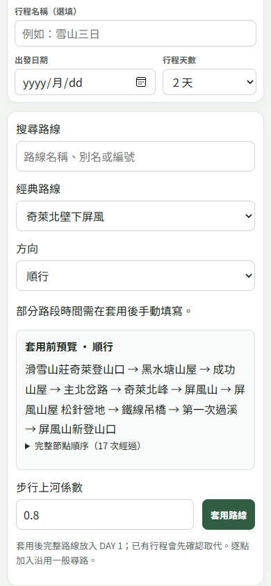

# IDEA-002：R057、套用前預覽與方向控制（2026-11-20）

本輪依使用者「繼續執行 UI 修改、R057 路線、套用前預覽、方向控制」確認執行。延續原 Preview 工作樹，沒有建立新分支、commit、推送或發布 UI。

## 已完成

- 固定上方來源切換、行程名稱、日期與天數區塊；圖組選單搬至獨立區塊。桌面仍同排，手機維持既有換列配置，切換來源不使欄位移動，也不增加橫向捲動。
- 「顯示 n／m」移到「＋手動終點」旁，保留三種顯示模式與批次管理；寬畫面留一個按鈕左右空隙，窄畫面縮小間隔、維持同一行及 44px 高操作區。
- 選定路線後立即顯示來源線形示意、起迄標記、重要節點走法與可展開的完整 occurrence 清單；切換方向同步反轉順序，含折返的重複經過不去重。選擇、搜尋與預覽不改目前 DAY。
- 環型與縱走才顯示順／逆向；往返與多段固定依已定義順序，不顯示方向控制。資料層保留既有反向驗證能力。
- 沿用套用時取代全部 DAY 的確認與復原／重做；空白行程直接套用，保留行程名稱、日期。
- R057 可預覽並套用正反兩方向。北峰至屏風的 4.009km OSM 北稜使用既存封存證據，不改權威步行圖；新來源僅進入 Route 專用 context。兩方向未知分鐘維持 null、由使用者手動填寫；不冒充上河時間、也不由係數推算。既有 6 個 OSM 區塊雜湊及 DEM 用到的區塊逐檔核對，沿來源線形約 30m DEM 取樣。

## 資料同步與位置規則

本機資料同步至已發行 main 38250450713bf1232eaded1860db24aa30106309，包含兩筆指定座標、屏風 OSM 路徑、16 筆主名與別稱、先前 G11/G12 核准修正。同步前舊檔保存在忽略的 .idea003-test-temp/ui-resume-backup；沒有重新核准或修改其資料內容。

原始 Sheet 與原始基準 65d10c5 不被改寫；decisions.dataCommit 與候選 catalog.dataCommit 明列本次使用的已發行資料基準。候選重新編譯，graph digest 及個別 span digest 重新核對，避免仍讀舊座標與舊名稱。

統一沿用來源 Node ID／有向路段／span 對應確認路徑，不要求標示座標落在線上。地點範圍及座標偏移不構成新增直線、改 Node ID 或合併附近點的依據；有來源的路徑可獨立於標示座標使用。真正缺少方向或線形、來源異動／歧義仍阻擋。R057 原始 OSM 證據檔保持其當時候選狀態，實際接入紀錄另保存在 catalog.supplement，沒有追改歷史證據或宣稱現地通行核實。

## 驗證

- 完整 JavaScript（含 Preview）：306/306 PASS。
- 完整 Python：128/128 PASS。
- 座標／幾何同步守門、候選可重現編譯、R057 原始 OSM 證據重現、diff check PASS。
- 隔離無頭 Edge：22 個操作情境 PASS，pageerror 空；包含 R057 正反預覽與套用、手動 217 分鐘實際 Excel 下載讀回、JSON 匯入、顯示三模式、地圖同步、取代取消／確認、復原重做、分天與刷新。
- 320／390／768／1280px 按鈕同排、頁面無水平溢出、切換來源欄位文件座標不變。390px 與桌面截圖已檢視。沒有真實 iPhone／Android 裝置驗證。

## 保留範圍

R026 的未核實連接、R052 的多段／車行 parts 與來源審核、聚合線形中間未知點精確分天，以及現地雙向通行確認仍為後續項目；不藉本輪 UI 授權擴張權威資料。正式網站仍只有前一輪已發布的資料補丁，這批 UI 在本機 Preview。
