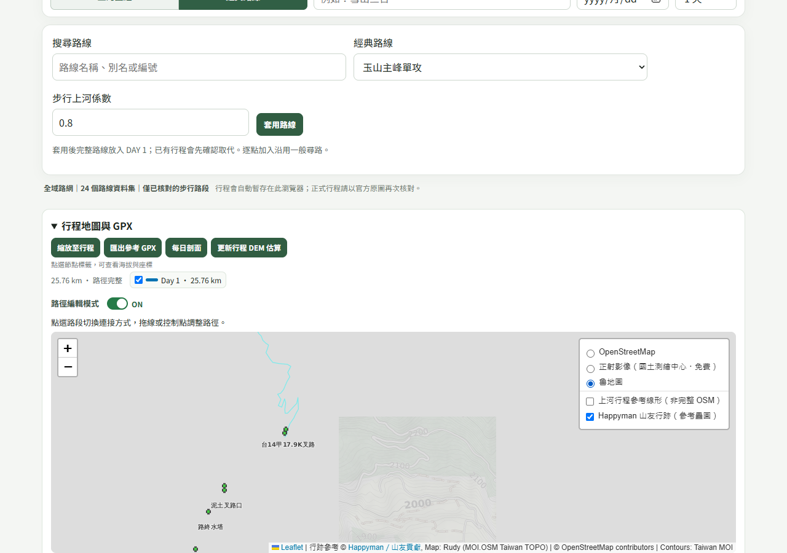

# 伊澤山第二登山口、顯示管理與行跡疊圖

## 資料更新

g04-020 採 EPSG:3826 (274493,2707010)，WGS84 (121.2416210,24.4692120)，DEM3216.1m。固定來源OSM/DEM局部重算，實際變更3條相鄰線形，其餘695條及所有非目標節點保持相同；原方向時間不變。PR #36已合併，data-ize-coordinate-20261123已發行，正式站部署內容已核對一致。

## Preview UI

顯示管理改為12px、透明底與低對比文字按鈕，桌面28px、窄畫面32px高，移除明顯藍灰底框。保持行程表左上角位置。

Happyman 原與魯地圖使用同一tilePane，圖層控制器的後續底圖順序可能遮住疊圖。新增happymanTracksPane（zIndex250），位於底圖200之上、行程及編輯線形之下；pointer-events:none，不阻擋路徑操作。

隔離Edge實際選取魯地圖與Happyman，確認兩者圖磚載入且自然寬度大於0、pane順序正確、無pageerror。手機畫面已目視檢視。UI修正仍為本機Preview，未包含於資料發行。

## 驗證

資料分支：JavaScript157/157、Python123/123、GitHub CI與同步守門通過。整合Preview：JavaScript312/312、Python128/128，原操作回歸、實際圖磚、320/390/768/1280px及125%放大驗收通過。
